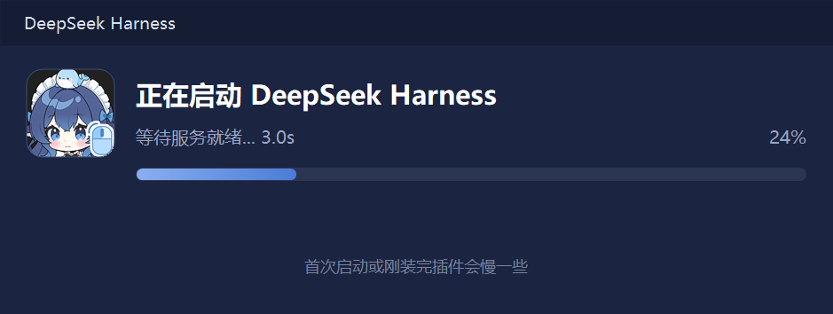
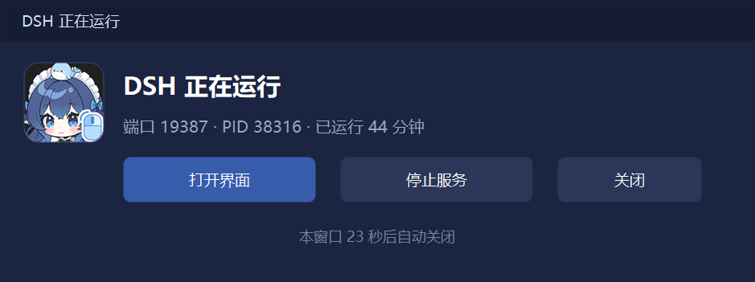

# 大肥鱼启动器（鲸鱼娘版） v0.3

复刻「启动画面 + 运行状态窗」的桌面启动器，单文件、零依赖、可整目录删除。

## 使用
- 桌面「大肥鱼」快捷方式双击即可。
- 若 DSH 已在运行 → 直接弹出「大肥鱼 正在运行」窗口（端口 / PID / 已运行时长 + 两行五个按钮）。
- 若 DSH 未运行 → 先显示「正在启动大肥鱼」进度窗，服务就绪后自动切到运行状态窗。

## v0.3 更新（2026-10-10）
- 标题下方新增 **100 条随机寄语**：每次打开都换一句，连续两次必不重样（GUID 种子 + 记住上次索引）
- 左上角大头像换成**完整的鲸鱼娘立绘**（头顶小鲸鱼 + 头饰 + 脸）
- **五个按钮各有专属小头像**，色调一眼可辨
- 按钮改**两行布局**：上行 打开界面 / 检查插件 / 检查本体，下行 启动语音 / 关闭
- 「打开界面」变**开关**：DSH 窗口可见时显示「关闭界面」（发 WM_CLOSE 收进托盘，不杀进程）
- 「检查插件」变**两段式**：先查（显示可更新数量）→ 再点才真的执行更新
- 「启动语音」变**开关**：手动拉起 / 关闭 GSV 引擎（端口 9880）
- 白色元素点缀（白+金混色星星、白色虚线光环、内侧白细线）+ 金色描边加宽到 3.4

## 文件
- `DSH.exe`          启动器本体（约 465 KB，内含头像资源与图标）
- `launcher.ini`     配置 exe 路径与端口（删除后自动探测）
- `updater.mjs`      插件 / 本体更新用的 Node 脚本
- `使用说明.txt`     面向使用者的说明
- `src/DSHLauncher.cs`  源码
- `build/`           头像素材与生成脚本（`_make_avatars4.py`、`_make_avatar_full.py`、`AVATARS.md`）
- `build.ps1`        重新编译脚本（csc v4.0.30319；⚠️ 编译前先关掉正在运行的 DSH.exe，否则报 CS0016）
- `app.manifest`     内嵌 asInvoker 清单（免 UAC）

## 备注
- 窗口内按 Esc 可直接关闭。
- 卸载：删除本目录与桌面快捷方式即可，不改注册表、不开机自启。
- 运行时会生成 `logs/`、`last-report.json`；`shots/` 是开发时的截图，发布包不含这三者。

## 开源
- 仓库地址：<https://github.com/Shione0721/dafish-launcher>
- 许可证：MIT
- 从源码构建：`powershell -ExecutionPolicy Bypass -File build.ps1`（只用系统自带的 csc.exe，不需要装 .NET SDK；编译前请先关闭正在运行的 `DSH.exe`）
- 构建产物 `DSH.exe` 已经随仓库提供，只想用的话直接下载这个文件即可。

## 截图

